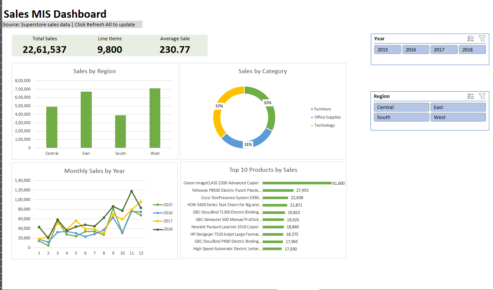
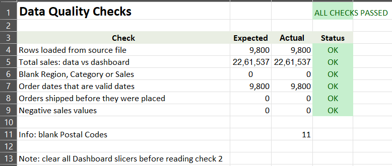

# Sales MIS Report (Excel)

A refreshable monthly sales report built in Excel: data loaded and cleaned with Power Query, summarised with PivotTables, shown on an interactive dashboard, and protected by a data-quality checks sheet.

## What it does
- Loads 9,800 rows of sales data from a CSV file using **Power Query**
- Summarises sales by region, category, month and product with **PivotTables**
- Shows KPI cards (total sales, line items, average sale) and four charts on one **Dashboard** sheet
- **Slicers** for Year and Region filter every card and chart at once
- A **Data_Checks** sheet validates the data and reports an overall pass or fail status

## Sheets
| Sheet | Purpose |
|---|---|
| Dashboard | KPI cards, four charts, Year and Region slicers |
| Data_Checks | Six data-quality checks and an overall status |
| Data | The cleaned table loaded by Power Query |
| P_Region, P_Category, P_Monthly, P_TopProducts, P_KPI | PivotTables that feed the dashboard |

## Key numbers
- Total sales: **22,61,537** (2,261,537) across **9,800** line items, average sale **230.77**
- Sales by year: 2015 about 4.80 lakh, 2016 about 4.59 lakh, 2017 about 6.00 lakh, 2018 about 7.22 lakh
- Top product: **Canon imageCLASS 2200 Advanced Copier**, about 61,600 in sales

## Insights from the report
- Sales dipped about 4% in 2016, then grew about 31% in 2017 and about 20% in 2018
- Sales peak late in the year: months 9, 11 and 12 are the strongest across all four years
- Category sales are fairly even: Technology 37%, Furniture 32%, Office Supplies 31%
- West and East are the strongest regions; South is the weakest

## Data cleaning and validation
- Dates are in DD/MM/YYYY format. I checked that they load day-first (a value like 14-06-2017 cannot be month-first) and added a check that no order ships before it is placed
- Added Year, Month and Month Name columns for reporting
- Totals were cross-checked against the same data analysed with SQL (matching to the rupee)
- **Data_Checks** compares: row count, total sales (data vs dashboard), blank Region/Category/Sales, valid order dates, ship date before order date, and negative sales
- Known data gap: 11 rows have a blank Postal Code (documented, not used in the report)

## How to use
1. Download `Sales_MIS_Report.xlsx` and `sales.csv` into the same folder
2. Open the workbook and click **Enable Content**
3. If Excel cannot find the file, go to **Data → Get Data → Data Source Settings**, choose the query, click **Change Source**, and point it to your copy of `sales.csv`
4. Click **Data → Refresh All** to reload and re-clean the data
5. Use the Year and Region slicers on the Dashboard. Clear both slicers before reading the "total sales" check on Data_Checks

## Skills used
Excel, Power Query, PivotTables and PivotCharts, slicers, GETPIVOTDATA, structured table references, conditional formatting, data validation checks

## Limitations
- Works with one source table. The "expected row count" on Data_Checks is a control total that must be updated by hand when the source file changes
- Power Query reads dates using the computer's regional settings. On a computer with US settings, set the date columns to the English (United Kingdom) locale
- Refreshing with a new month's file has not been tested yet

## Data
`sales.csv` is a public sample retail dataset (Superstore), used for practice.

Built by [Roop-code134](https://github.com/Roop-code134)
